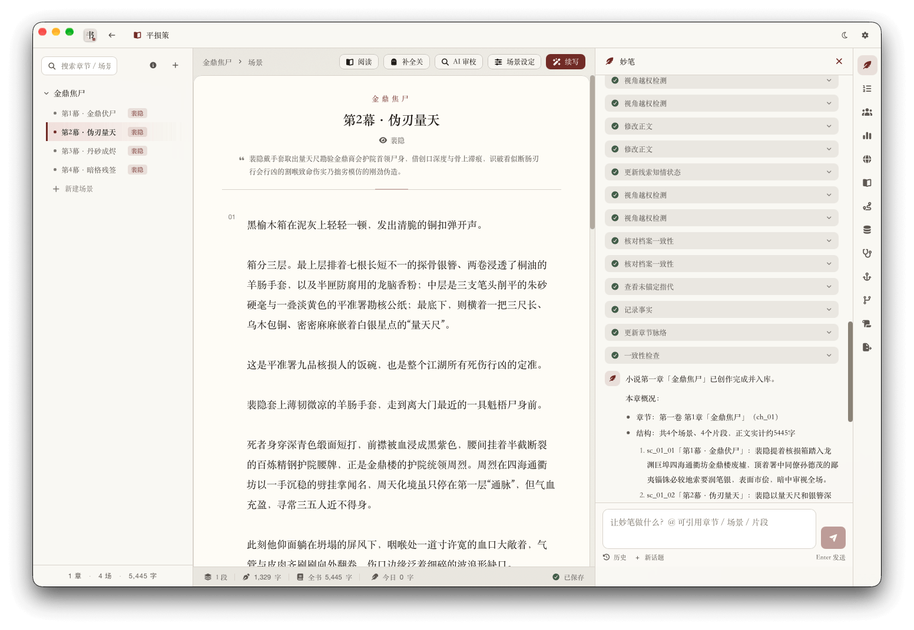

# StoryStudio

写给长篇小说的「写作 IDE」。你的整部小说就是磁盘上的一个纯文本项目（TOML + Markdown）：
不锁数据、不怕丢稿，任何编辑器都打得开；Rust 内核负责解析、质检与知识沉淀，
桌面端 / CLI / 外部 AI Agent 三种入口操作同一份项目，完全互操作。



[](https://github.com/taiyuuki/StoryStudio/actions/workflows/ci.yml)
[](https://github.com/taiyuuki/StoryStudio/actions/workflows/release.yml)

## 下载安装

从 [Releases](https://github.com/taiyuuki/StoryStudio/releases/latest) 选择你的平台：

| 平台 | 安装包 |
|------|--------|
| macOS（Apple Silicon / Intel） | `.dmg` |
| Windows | `.msi` / `.exe` |
| Linux | `.deb` / `.rpm` / `.AppImage` |

附带三平台 `story-studio` CLI 二进制，可直接下载使用。

旧版本用户无需重装：桌面端启动时自动检查更新（也可在「设置 → 关于」手动检查），
应用内下载、重启即完成升级。

## 它能帮你做什么

- **沉浸写作**：纸面质感衬线排版，长场景按片段分片管理；中文输入法组词保护、
  片段版本历史随时回退、手写 / AI 双码字账本各记各的
- **掌控结构**：卷 › 章 › 场景树逐层展开，每个场景可设定 POV、情绪与故事时间，
  大纲与叙事线索的知情状态由正文自动推导
- **设定不再失控**：角色 / 地点 / 道具 / 组织四类实体与关系网；知识断言 + 证据链，
  每条设定都可回溯到写下它的那一段正文
- **自动质检**：25 条内置检查（死亡角色复活、年龄矛盾、孤儿引用……）在你改动后自动重查；
  AI 产出遇到硬伤当场暂停，等你决策再继续
- **AI 深度协作**：续写一句话接上你的文风；「妙笔」对话式改稿、查设定、记录事实；
  逐章成书流水线（节拍 → 整章 → 质检）自动跑完一章；多档案多 Provider，按用途分配模型
- **完全开放**：CLI 开箱即用；内置 MCP 服务器把项目工具集暴露给任意 Agent，
  支持只读模式与跨进程读写闸门

完整功能表见 [app/README.md](app/README.md)。

## 三种入口，一份项目

**桌面端**——下载即用，上图即工作台：左侧章节树、中间纸面编辑器、
右侧妙笔面板与功能轨道。

**CLI**——脚本化与无界面环境：

```bash
story-studio init 我的小说                    # 新建项目
story-studio compile -d <项目目录>            # 解析 + 全量检查
story-studio export -d <项目目录> -f markdown -o out --appendix
story-studio write -d <项目目录> -s <场景ID>  # AI 续写
story-studio workflow run -d <项目目录>       # 逐章成书流水线
```

**MCP**——交给外部 Agent 操作：

```bash
story-studio mcp -d <项目目录>                     # stdio，由客户端拉起
story-studio mcp -d <项目目录> --transport http    # HTTP 常驻
story-studio mcp --workspace <目录>                # 工作区模式：Agent 可建书 / 切书
```

加 `--read-only` 只暴露查询类工具，不修改项目。

## 开发者

前置要求：Rust stable、Node ≥ 22、pnpm 12。

```bash
cd app
pnpm install
pnpm tauri dev      # 开发（vite :5190 + Rust 自动重编译）
pnpm tauri build    # 打包 .app / .dmg（macOS）
```

测试与检查：

```bash
cargo test --workspace --exclude story-studio-app   # Rust 库 + CLI
cargo fmt --all --check && cargo clippy --workspace --exclude story-studio-app --all-targets -- -D warnings
cd app && pnpm test && pnpm build                   # 前端测试 + 构建检查
```

仓库为 Cargo workspace（`crates/` 下 IR / 解析 / 编译 / 知识 / 导出 / AI runtime /
MCP / CLI 等）+ `app/` Tauri 2 桌面端，设计文档见 [rfc/README.md](rfc/README.md)
（RFC-0001 起，逐篇标注实现状态）。

<details>
<summary>发版流程（维护者）</summary>

推送 `v*` tag 触发 [release.yml](.github/workflows/release.yml) 自动发布：

1. 同步四处版本号：根 `Cargo.toml`（workspace）、`app/src-tauri/tauri.conf.json`、
   `app/src-tauri/Cargo.toml`、`app/package.json`，并刷新 `Cargo.lock`
2. `git tag vX.Y.Z && git push origin vX.Y.Z`

CI 构建三平台桌面安装包与 CLI 二进制发布到 GitHub Release，并产出应用内更新产物
（`latest.json`）。tag 与 `tauri.conf.json` 版本不一致时流水线直接报错。

更新签名密钥：私钥存 GitHub secret `TAURI_SIGNING_PRIVATE_KEY`（本地备份于
`~/.tauri/storystudio.key`，**务必另外备份**，丢失则已安装用户收不到后续更新），
公钥固化在 `app/src-tauri/tauri.conf.json` 的 `plugins.updater.pubkey`。

</details>

## 文档

- [app/README.md](app/README.md) — 桌面端功能全表与结构说明
- [rfc/README.md](rfc/README.md) — 设计文档索引

## License

MIT
